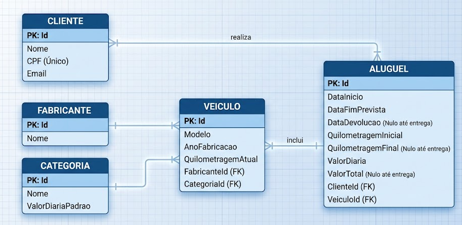

# Locadora de Veiculos & API de Produtos

Modelagem relacional para a gestão de uma locadora de veículos (clientes, fabricantes, categorias, veículos e alugueis) e módulo de controle de estoque de **Produtos** (Semana 15) com integridade referencial no SQL Server via Entity Framework Core.

## Modelagem do Banco de Dados

---

## 📦 Módulo de Cadastro de Produtos (Semana 15)

O módulo de produtos permite o gerenciamento completo de estoque e catálogo com persistência no SQL Server via Entity Framework Core.

### Atributos do Produto:
* `Nome`: Nome do produto
* `Codigo`: Código único de identificação
* `Preco`: Preço unitário (decimal)
* `Descricao`: Descrição detalhada do produto
* `QuantidadeEstoque`: Quantidade disponível em estoque
* `Avaliacao`: Avaliação de 0 a 5
* `Categoria`: Categoria do produto

### Rotas do CRUD:
* `POST /produtos` (ou `/api/produtos`): Criação de produtos
* `GET /produtos` (ou `/api/produtos`): Leitura de todos os produtos
* `GET /produtos/{id}`: Leitura por ID
* `GET /produtos/codigo/{codigo}`: Leitura por código do produto
* `GET /produtos/categoria/{categoria}`: Leitura filtrada por categoria
* `PUT /produtos/{id}`: Atualização completa do produto
* `PATCH /produtos/{id}`: Atualização parcial de dados
* `DELETE /produtos/{id}`: Exclusão de produto
